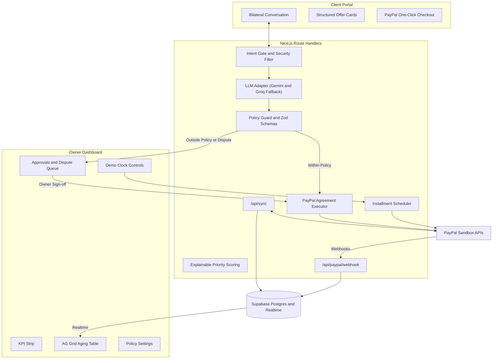

# PulsePay — AI-Powered Receivables & Invoicing Assistant
> **PayPal AI Hackathon 2026** · Tech Stack: Next.js 16 (App Router), TypeScript, Tailwind CSS, Supabase, PayPal Agent Toolkit & Invoicing v2.  
> **Live Production URL**: [https://pulsepay-rho.vercel.app](https://pulsepay-rho.vercel.app)  
> **Team Status & Handoff Guide**: See [docs/CURRENT_STATUS.md](./docs/CURRENT_STATUS.md)

PulsePay is an autonomous, polite AI assistant designed for freelancers and small businesses that:
1. Identifies and prioritizes overdue PayPal invoices using explainable AI scoring.
2. Initiates personalized follow-ups respecting merchant tone and anti-debt-collector posture.
3. Negotiates mutually beneficial settlement terms on a dedicated client portal:
   - **PayPal Pay Later** (merchant gets paid in full upfront, client pays over time)
   - **Early-payment discounts** (e.g. 5% off if cleared within 48h via Void & Reissue)
   - **Staged installment plans** (e.g. 3 × $400 scheduled in PayPal)
4. Enforces strict business policy guardrails via deterministic Zod schemas before any agreement can touch PayPal.
5. Features a live-updating AG Grid dashboard, an approval queue for exceptions, and a simulated **Demo Clock** for advance testing.

---

## Architecture Overview



---

## Quick Start (Local Setup)

### 1. Prerequisites
- Node.js 20+ & npm
- Git

### 2. Clone and Install
```bash
git clone https://github.com/Oubay-S/pulsepay.git
cd pulsepay
npm install
```

### 3. Environment Variables
Copy `.env.example` to `.env.local`:
```bash
cp .env.example .env.local
```
Configure your keys or use the team shared Supabase instance detailed in [docs/CURRENT_STATUS.md](./docs/CURRENT_STATUS.md):

| Variable | Description |
|---|---|
| `NEXT_PUBLIC_APP_URL` | Base application URL (`http://localhost:3000`) |
| `NEXT_PUBLIC_SUPABASE_URL` | Supabase project URL |
| `NEXT_PUBLIC_SUPABASE_ANON_KEY` | Supabase public anon key |
| `SUPABASE_SERVICE_ROLE_KEY` | Supabase service-role secret key (server routes & webhooks) |
| `PAYPAL_ENVIRONMENT` | `sandbox` |
| `PAYPAL_CLIENT_ID` | PayPal Sandbox App Client ID |
| `PAYPAL_CLIENT_SECRET` | PayPal Sandbox App Secret |
| `PAYPAL_WEBHOOK_ID` | PayPal Sandbox Webhook ID |
| `LLM_PRIMARY_API_KEY` | Google AI Studio Gemini API key (free tier) |
| `LLM_FALLBACK_API_KEY` | Groq API key (free tier) |

### 4. Verify Backend & Seed Demo Data
Verify database connectivity and sample scenarios:
```bash
# Run local verification suite:
npm run test:api

# Run unit test suite (17 tests):
npm test

# Re-seed demo database if needed:
npm run seed
```

### 5. Run Development Server
```bash
npm run dev
```
Visit `http://localhost:3000` for the dashboard and `http://localhost:3000/api/health` for the system status.

---

## PayPal Sandbox (Judges)

All PayPal activity in PulsePay is **real** and runs in **PayPal Sandbox**:

- invoices are created, sent, and cancelled through **Invoicing v2**
- discounts, installment plans, and Pay Later use real PayPal APIs
- payments are confirmed by verified PayPal webhooks
- only the demo clock is simulated

### Sandbox buyer

| Field | Value |
|---|---|
| Email | `sb-seg43053775887@personal.example.com` |
| Password | `b@1^!qB0` |
| Region | **US** — required for the Pay Later flow |

> Sandbox test account only — no real money, no real cards.

### What to try

1. Open the demo and pick an unpaid invoice.
2. Accept the early-payment discount → pay the reissued invoice with the Sandbox buyer → the invoice turns `PAID`.
3. Accept the 3-installment plan → installment 1 is sent → advance the demo clock → installment 2 is sent.
4. Choose **Pay Later** → log in as the US buyer → approve **Pay in 4** → the invoice turns `PAID`.
5. Watch the dashboard row turn green after the webhook arrives.

PayPal webhook endpoint:

```
https://pulsepay-rho.vercel.app/api/paypal/webhook
```

Pay Later appears only for eligible Sandbox buyers; it is shown honestly as “if PayPal offers it to you.”

---

## API Reference

### Infrastructure & Demo
| Method | Endpoint | Description |
|---|---|---|
| `GET` | `/api/health` | Uptime health check (returns `status: "ok"`) |
| `POST` | `/api/demo/clock` | Advance simulated time (`{ "days": 7 }`) and trigger due installments |
| `POST` | `/api/demo/reset` | Restore demo business, clients, policies, and the 3 test scenarios |
| `POST` | `/api/scheduler/run` | Process pending scheduled installments due as of current/simulated date |

### Merchant / Owner
| Method | Endpoint | Description |
|---|---|---|
| `GET` | `/api/invoices` | List invoices with client details and computed KPIs for AG Grid |
| `GET/PUT`| `/api/policy` | Retrieve or update owner negotiation policies |
| `GET` | `/api/approvals` | List arrangements requiring manual owner sign-off |
| `POST`| `/api/approvals/:id` | Approve, reject, or counter a pending proposal |

### Agent & Client Portal
| Method | Endpoint | Description |
|---|---|---|
| `POST` | `/api/sync` | Sync invoices from PayPal Sandbox merchant account |
| `POST` | `/api/invoices/:id/follow-up` | Generate contextual agent follow-up and create client link |
| `GET` | `/api/c/:token` | Fetch client-facing thread, invoice summary, and active offers |
| `POST` | `/api/c/:token/message` | Client message -> Intent gate -> LLM turn -> Policy guard |
| `POST` | `/api/c/:token/accept` | Client accepts an offer -> PayPal executor executes agreement |

### PayPal Webhook
| Method | Endpoint | Live Production URL |
|---|---|---|
| `POST` | `/api/paypal/webhook` | `https://pulsepay-rho.vercel.app/api/paypal/webhook` |

Handles `INVOICING.INVOICE.PAID`, `PAYMENT.CAPTURE.COMPLETED`, and `INVOICING.INVOICE.CANCELLED` with cryptographic signature verification.

---

## Security & Guardrails

- **Zero Direct LLM Money Movement**: The LLM possesses only read tools and proposal generation tools (`propose_offer`, `escalate`, `flag_dispute`). Real actions run exclusively through `executeAgreement()` in backend code.
- **Intent Gate**: Every incoming client message is audited before the agent responds. Disputed work immediately suspends automation and alerts the owner; prompt injections ("ignore rules", "owner approved 90%") are politely refused.
- **Strict Zod Policy Guard**: Enforces max discounts, minimum first installment percentages, maximum number of installments, and flags amounts exceeding the approval threshold for owner sign-off.
- **PayPal Webhook Verification**: Cryptographically verifies incoming events against PayPal's verification endpoint with all transmission headers before processing.

---

## Hackathon Team Roles & Branch Mapping
- **Oubay**: Tech Lead & Backend (`main`) — Repo, schema, API endpoints, policy guard, executor, scheduler, deploy.
- **Omar**: PayPal Integration (`feat/omar-paypal-toolkit`) — Sandbox, Agent Toolkit, webhooks, checkout flows.
- **Reda**: AI Agent Engineering (`feat/reda-agent-prompts`) — Prompts, intent gate, LLM fallback, adversarial testing.
- **Taha**: Frontend Architecture (`feat/taha-dashboard-ui`) — AG Grid aging table, KPI strip, dashboard layout.
- **Soulaimane**: Client UX & Messaging (`feat/soulaimane-client-portal`) — Client portal, offer cards, interaction flows.
- **Mohamed**: Data, Scoring & QA (`feat/mohamed-scoring-data`) — Priority scoring algorithm, dataset scenarios, E2E validation.
